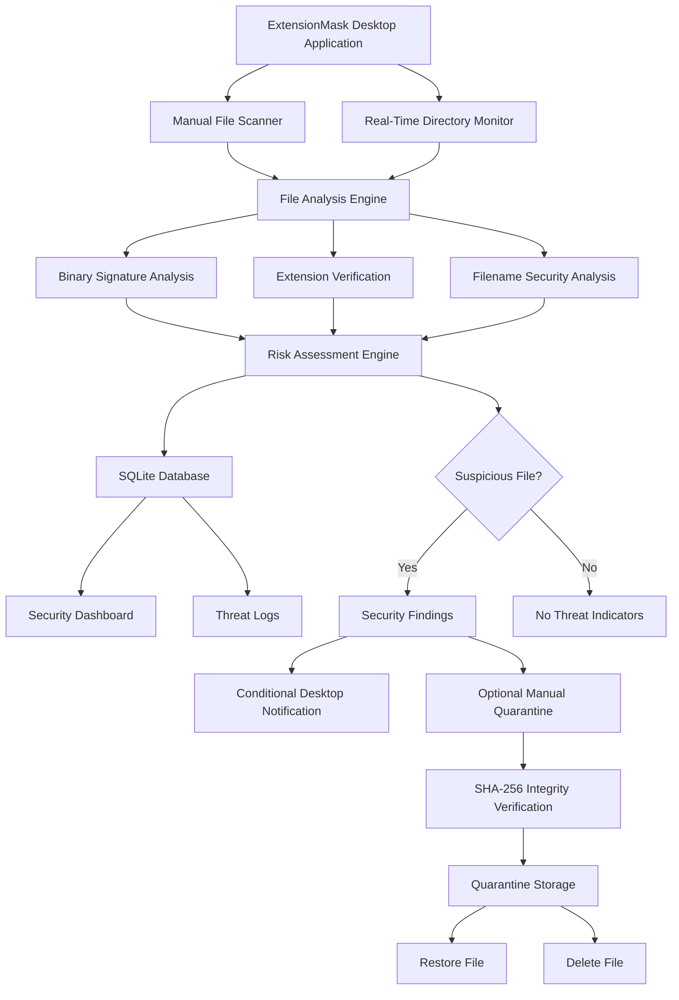

# ExtensionMask

### File Identity Spoofing Detection and Monitoring System


## Overview

ExtensionMask is a Python-based cybersecurity desktop application designed to detect potentially malicious files disguised using misleading file extensions, deceptive filenames and hidden Unicode characters.

The system analyzes the internal binary signatures (magic bytes) of files and compares their detected file types with their declared extensions to identify potential file identity spoofing attempts.

ExtensionMask combines manual file scanning, real-time directory monitoring, heuristic risk assessment, security incident logging, desktop notifications and file quarantine within a unified graphical interface.

This project was developed as a **college mini project under Cybersecurity Analysis and Monitoring**.

---

## Problem Statement

Attackers often disguise potentially malicious files as legitimate documents, images or other commonly used file formats to deceive users into opening them.

Since changing a file's extension does not change its internal binary structure, relying solely on filenames can expose users to security threats.

ExtensionMask addresses this problem through automated file identity verification, filename security analysis and continuous directory monitoring.

---

## Objectives

- Detect potential file identity spoofing attempts.
- Identify mismatches between declared and actual file types.
- Monitor selected directories in real time.
- Detect deceptive filename manipulation techniques.
- Classify suspicious files using heuristic risk assessment.
- Generate security alerts for suspicious file activity.
- Provide manual file isolation and recovery mechanisms.
- Maintain security incident records for further analysis.
- Improve awareness of file-based cybersecurity threats.

---

## Features

| Feature | Description |
|---|---|
| Manual File Scanning | Scan individual files or entire directories. |
| Real-Time Monitoring | Monitor newly created, modified and renamed files. |
| Magic Byte Analysis | Identify file formats using internal binary signatures. |
| Extension Mismatch Detection | Detect inconsistencies between declared and actual file types. |
| Double Extension Detection | Identify deceptive filenames such as `invoice.pdf.exe`. |
| Unicode Analysis | Detect suspicious hidden and bidirectional Unicode characters in filenames. |
| Risk Assessment | Assign heuristic risk scores between 0 and 100. |
| Threat Classification | Categorize suspicious files according to severity. |
| Security Dashboard | Visualize file scanning statistics and security activity. |
| Threat Logs | Maintain searchable and filterable security incident records. |
| CSV Export | Export security incident records for further analysis. |
| File Quarantine | Manually isolate suspicious files from their original locations. |
| File Restoration | Restore quarantined files to their original locations. |
| File Deletion | Permanently remove selected quarantined files. |
| Integrity Verification | Verify quarantined files using SHA-256 hashes. |
| Desktop Notifications | Generate Windows desktop alerts for qualifying suspicious files. |
| Notification Cooldown | Reduce repeated notifications for the same file and severity. |
| Configurable Settings | Customize monitoring duration, scan delay and notification preferences. |
| Persistent Logging | Maintain application logs with automatic log rotation. |
| Windows Executable | Run the application without a separate Python installation. |

---

## Working Methodology

1. The user selects a file or directory for manual scanning or real-time monitoring.
2. The system identifies the file to be analyzed.
3. The declared file extension is extracted.
4. The internal binary signature of the file is analyzed.
5. The detected file type is compared with the declared extension.
6. Additional filename manipulation checks are performed.
7. A heuristic risk score and severity level are assigned.
8. Scan results are stored in the SQLite database.
9. Security alerts are generated when configured notification conditions are satisfied during live monitoring.
10. Suspicious files can be manually quarantined for further investigation.

---

## System Architecture



---

## Core Security Mechanisms

### 1. Magic Byte Analysis

Magic bytes are distinctive sequences of binary data that help identify file formats independently of their declared extensions.

| File Type | Magic Bytes (Hexadecimal) |
|---|---|
| PDF | `25 50 44 46` |
| JPEG | `FF D8 FF` |
| PNG | `89 50 4E 47 0D 0A 1A 0A` |
| Windows Executable (MZ header) | `4D 5A` |
| ZIP Archive | `50 4B 03 04` |
| GIF | `47 49 46 38` |

For example, if a file named `photo.jpg` contains a Windows executable signature instead of a JPEG signature, ExtensionMask flags the file for further investigation.

Binary signatures provide useful identification indicators but do not guarantee that a file is valid or safe.

### 2. Extension Mismatch Detection

The system compares the declared file extension with the detected internal file format.

For example:

- Declared filename: `document.pdf`
- Detected file type: JPEG
- Analysis result: Extension mismatch

### 3. Deceptive Double Extension Detection

Attackers may use multiple extensions to disguise executable or potentially dangerous files as legitimate documents.

Examples include:

- `invoice.pdf.exe`
- `assignment.docx.exe`
- `photo.jpg.scr`

ExtensionMask identifies suspicious double-extension patterns using predefined detection rules.

### 4. Unicode Filename Analysis

Certain Unicode characters can alter the visual appearance or reading direction of filenames.

ExtensionMask analyzes filenames for suspicious hidden and bidirectional Unicode characters that may be used to conceal the actual file extension.

### 5. SHA-256 Integrity Verification

ExtensionMask calculates a SHA-256 hash when a suspicious file is quarantined.

The stored hash can later be compared with the current hash of the quarantined file to identify unexpected modifications.

Hash verification checks file integrity; it does not determine whether a file contains malware.

---

## Risk Assessment Methodology

ExtensionMask uses a rule-based heuristic scoring mechanism to estimate the potential risk associated with detected file identity anomalies.

### Risk Scoring Rules

| Security Indicator | Risk Points |
|---|---:|
| File extension mismatch | +40 |
| Deceptive double extension | +50 |
| Suspicious Unicode characters | +30 |
| Potentially dangerous file extension | +20 |
| Executable disguised as another file type | +60 |

Multiple applicable indicators contribute to the final risk score, which is capped at 100.

### Severity Classification

| Risk Score | Severity |
|---|---|
| 80–100 | Critical |
| 60–79 | High |
| 30–59 | Medium |
| 1–29 | Low |
| 0 with no detected indicators | None |
| Unverified without risk indicators or failed analysis | Unknown |

Risk scores represent predefined heuristic indicators and should not be interpreted as the statistical probability that a file contains malware.

---

## Example Detection Scenarios

| Filename | Detected File Type | Analysis Result | Risk Score |
|---|---|---|---:|
| `assignment.pdf` | PDF | No mismatch | 0 |
| `vacation.jpg` | Windows Executable | Disguised executable | 100 |
| `invoice.pdf.exe` | Windows Executable | Deceptive double extension | 70 |
| `document.png` | JPEG | Extension mismatch | 40 |
| `archive.zip` | ZIP Archive | No mismatch | 0 |
| `unknown.xyz` | Unknown | Unverified file type | 0 |

These examples illustrate the expected results under the implemented detection and risk assessment rules.

---

## Application Modules

### Dashboard

Provides an overview of file scanning statistics, suspicious file activity, severity distribution and recent security events.

### File Scanner

Allows users to manually scan individual files and directories for file identity anomalies and suspicious filename characteristics.

### Live Monitor

Continuously monitors a selected directory and analyzes newly created, modified or renamed files.

Supports configurable monitoring durations and scan delays.

### Threat Logs

Maintains historical records of suspicious file activity using SQLite.

Supports searching, filtering, detailed inspection and CSV export.

### Quarantine

Provides manual isolation of suspicious files, SHA-256 integrity verification, restoration and permanent deletion.

### Settings

Allows users to configure:

- Monitoring duration
- File scanning delay
- Desktop notification preferences
- Minimum notification severity
- Notification cooldown interval

---

## Technology Stack

| Technology / Library | Purpose |
|---|---|
| Python | Core programming language |
| CustomTkinter | Modern desktop graphical user interface |
| Tkinter | Native GUI components and dialog boxes |
| Watchdog | Real-time file system monitoring |
| Filetype | Binary file signature identification |
| SQLite | Persistent security incident storage |
| Matplotlib | Security statistics and data visualization |
| Pillow | Image processing and graphical assets |
| Plyer | Desktop security notifications |
| Pathlib | File path and extension handling |
| OS | File system operations |
| Hashlib | SHA-256 file fingerprinting |
| UnicodeData | Unicode character analysis |
| Shutil | File quarantine and restoration operations |
| Threading | Background processing |
| Queue | Thread-safe event communication |
| Logging | Persistent application event logging |
| JSON | Application settings storage |
| CSV | Security incident report export |
| Pytest | Automated software testing |
| PyInstaller | Windows executable packaging |
| Git and GitHub | Version control and project distribution |

---

## Project Structure

```text
ExtensionMask/
│
├── core/
│   ├── __init__.py
│   ├── detector.py
│   ├── scanner.py
│   ├── monitor.py
│   ├── risk_analyzer.py
│   ├── quarantine.py
│   └── signatures.py
│
├── gui/
│   ├── __init__.py
│   ├── app.py
│   ├── dashboard.py
│   ├── file_scanner.py
│   ├── live_monitor.py
│   ├── threat_logs.py
│   ├── quarantine_view.py
│   ├── settings.py
│   └── theme.py
│
├── database/
│   ├── __init__.py
│   └── db.py
│
├── utils/
│   ├── __init__.py
│   ├── logger.py
│   └── notifications.py
│
├── assets/
│
├── data/
│   ├── logs/
│   ├── quarantine/
│   ├── extensionmask.db
│   └── settings.json
│
├── tests/
│   ├── test_detector.py
│   ├── test_scanner.py
│   └── test_quarantine.py
│
├── config.py
├── main.py
├── requirements.txt
├── ExtensionMask.spec
├── .gitignore
└── README.md
```

Runtime databases, application logs, local settings and quarantined files are generated locally and are excluded from version control.

---

## Installation and Setup

### Option 1 — Windows Executable

If a packaged Windows release is available:

1. Open the GitHub Releases section of this repository.
2. Download the Windows release ZIP archive.
3. Extract the entire archive.
4. Open the extracted ExtensionMask folder.
5. Double-click `ExtensionMask.exe`.

No separate Python installation is required.

Keep the `_internal` directory alongside the executable, as it contains the application's required runtime dependencies.

### Option 2 — Run from Source Code

#### Prerequisites

- Windows
- Python 3.x
- pip
- Git

Clone this repository using its GitHub clone URL and navigate to the project directory.

#### Create a Virtual Environment

```powershell
python -m venv .venv
```

#### Activate the Virtual Environment

```powershell
.\.venv\Scripts\Activate.ps1
```

#### Install Dependencies

```powershell
pip install -r requirements.txt
```

Alternatively, install the runtime dependencies manually:

```powershell
pip install customtkinter watchdog filetype matplotlib Pillow plyer
```

#### Launch the Application

```powershell
python main.py
```

---

## Usage

### Manual File Scanning

1. Launch ExtensionMask.
2. Navigate to the File Scanner page.
3. Select a file or directory.
4. Start the scanning process.
5. Review the detected file types, security findings and risk scores.

### Real-Time Monitoring

1. Navigate to the Live Monitor page.
2. Select a directory to monitor.
3. Configure monitoring preferences through Settings.
4. Start monitoring.
5. Review detected file activity and security notifications.
6. Stop monitoring when required.

### File Quarantine

1. Navigate to Threat Logs.
2. Select a suspicious file record.
3. Choose the quarantine action.
4. Confirm the operation.
5. Open the Quarantine page to manage the isolated file.

Quarantined files can be inspected, verified, restored or permanently deleted.

Only restore files that you have independently determined are safe.

### Security Incident Reports

1. Navigate to Threat Logs.
2. Apply the required search or filtering options.
3. Select the CSV export option.
4. Save the report to the desired location.

---

## Database and Logging

ExtensionMask uses SQLite to maintain persistent records of file scanning and quarantine operations.

### Scan Records

Stored information includes:

- Filename and file path
- Declared file extension
- Detected file type
- Analysis status
- Risk score and severity
- Security findings
- Scan source
- Scan timestamp

### Quarantine Records

Stored information includes:

- Original file location
- Quarantine location
- SHA-256 hash
- File size
- Risk score and severity
- Quarantine timestamp
- Quarantine status

### Application Logging

Application events are stored in:

```text
data/logs/extensionmask.log
```

The logging system uses automatic log rotation with a maximum target size of 2 MB per log file and up to three backup files.

This helps prevent excessive log storage during continuous application usage.

---

## Automated Testing

ExtensionMask includes automated tests for its core security functionality.

Install the testing dependency:

```powershell
pip install pytest
```

Run the complete test suite:

```powershell
python -m pytest tests/ -v
```

Check Python source files for syntax errors:

```powershell
python -m compileall -q core gui database utils config.py main.py
```

Testing should be conducted using harmless sample files in a controlled environment.

---

## Building the Windows Executable

Install PyInstaller:

```powershell
pip install pyinstaller
```

Build the application:

```powershell
python -m PyInstaller --noconfirm --clean --onedir --windowed --name ExtensionMask --collect-all customtkinter --collect-all filetype --hidden-import plyer.platforms.win.notification main.py
```

The generated executable will be available at:

```text
dist/ExtensionMask/ExtensionMask.exe
```

The complete `dist/ExtensionMask/` directory must be retained when distributing the application.

Verify scanning, monitoring, notifications, quarantine and data persistence in the packaged application before distribution.

---

## Applications

- Personal file security monitoring.
- Download directory monitoring.
- Preliminary suspicious file analysis.
- Detection of file masquerading techniques.
- Cybersecurity awareness and education.
- Basic digital forensic analysis.
- File-based security incident investigation.
- Defensive cybersecurity experimentation.

---

## Limitations

- An extension mismatch does not necessarily indicate malware.
- A matching extension does not guarantee that a file is safe.
- Certain file formats share similar binary signatures.
- Unknown or unsupported file formats may require additional analysis.
- Heuristic risk scores do not represent malware detection probabilities.
- Legitimate files may occasionally trigger security warnings.
- Real-time monitoring operates only while the application is running and monitoring is active.
- Desktop notification delivery depends on operating system settings.
- Quarantine provides local file isolation rather than an antivirus-grade security sandbox.
- Permanent deletion does not guarantee secure erasure of file contents.
- ExtensionMask does not perform comprehensive malware analysis or behavioral threat detection.
- The application is primarily designed for Windows environments.

ExtensionMask is intended to complement existing security practices, not replace conventional antivirus or endpoint protection software.

---

## Future Scope

Potential areas for future research and development include:

- VirusTotal API integration.
- Advanced file metadata analysis.
- File entropy analysis.
- YARA rule-based detection.
- Email attachment security analysis.
- Advanced security incident reporting.
- Cross-platform desktop support.

These capabilities are outside the scope of the current release.

---

## Project Status

**Version:** 1.0.0

**Development Status:** Completed

**Application Type:** Desktop Application

**Target Platform:** Windows

**Project Domain:** Cybersecurity Analysis and Monitoring

ExtensionMask has been developed as a functional college mini project demonstrating practical concepts in defensive cybersecurity, file identity verification, real-time monitoring, security incident management and desktop application development.

---

## Disclaimer

ExtensionMask is developed exclusively for educational and defensive cybersecurity purposes.

All scanning, monitoring and testing activities should be conducted on files and systems that the user owns or is authorized to analyze.

The application identifies potential file identity anomalies using predefined security rules and does not guarantee the detection or prevention of malware.

Users should exercise caution when handling suspicious files and use established security tools for comprehensive threat analysis.

---

**ExtensionMask | Cybersecurity Analysis & Monitoring | College Mini Project**
