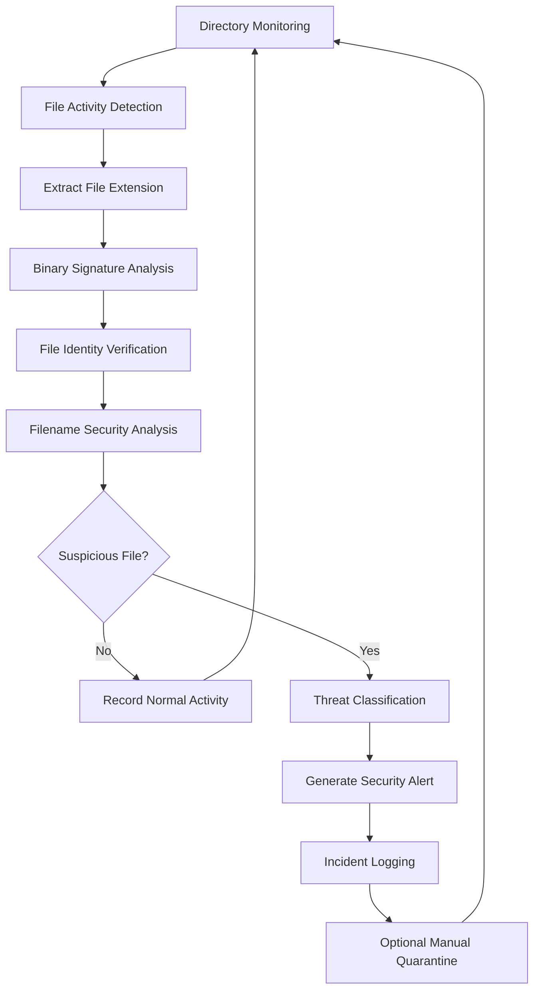

# ExtensionMask
### File Identity Spoofing Detection and Monitoring System


## Overview

ExtensionMask is a Python-based cybersecurity analysis and monitoring system designed to detect potentially malicious files disguised using misleading file extensions and deceptive filenames.

The system analyzes the internal binary signatures (magic bytes) of files and compares their detected file types with their declared extensions to identify potential file identity spoofing attempts.

This project is being developed as a **college mini project under Cybersecurity Analysis and Monitoring**.

## Problem Statement

Attackers often disguise potentially malicious files as legitimate documents, images or other commonly used file formats to deceive users.

Since changing a file's extension does not change its internal binary structure, relying solely on filenames can expose users to security threats.

ExtensionMask aims to address this problem through automated file identity verification and continuous directory monitoring.

## Objectives

- Detect file identity spoofing attempts.
- Identify mismatches between declared and actual file types.
- Monitor selected directories in real time.
- Detect deceptive filename manipulation techniques.
- Generate security alerts for suspicious files.
- Maintain security incident logs for further analysis.
- Improve awareness of file-based cybersecurity threats.

## Proposed Features

- **Real-Time File Monitoring:** Monitors newly created, modified and renamed files.
- **Magic Byte Analysis:** Identifies file formats using internal binary signatures.
- **Extension Mismatch Detection:** Detects inconsistencies between declared and actual file types.
- **Double Extension Detection:** Identifies deceptive filenames such as `invoice.pdf.exe`.
- **Unicode Analysis:** Detects suspicious hidden and bidirectional Unicode characters in filenames.
- **Threat Classification:** Assigns risk levels based on predefined detection rules.
- **Security Alerts:** Notifies users about suspicious files.
- **File Quarantine:** Allows users to manually isolate suspicious files.
- **Incident Logging:** Maintains a history of detected security events.
- **Monitoring Dashboard:** Displays file scanning statistics and security alerts.

## Working Methodology

1. The user selects a directory for monitoring.
2. The system continuously monitors file-related activities.
3. The declared file extension is extracted.
4. The file's internal binary signature is analyzed.
5. The detected file type is compared with the declared extension.
6. Additional filename manipulation checks are performed.
7. Suspicious files are classified according to their potential risk.
8. Security alerts and incident logs are generated.

## System Workflow



## Example Detection Scenarios

| Filename | Detected File Type | Analysis Result |
|---|---|---|
| assignment.pdf | PDF | No mismatch |
| vacation.jpg | Windows Executable | Extension mismatch |
| invoice.pdf.exe | Windows Executable | Deceptive double extension |
| document.png | JPEG | Extension mismatch |
| archive.zip | ZIP Archive | No mismatch |

## Magic Byte Analysis

Magic bytes are distinctive sequences of binary data that help identify file formats independently of their extensions.

| File Type | Magic Bytes (Hexadecimal) |
|---|---|
| PDF | 25 50 44 46 |
| JPEG | FF D8 FF |
| PNG | 89 50 4E 47 0D 0A 1A 0A |
| Windows Executable (MZ header) | 4D 5A |
| ZIP | 50 4B 03 04 |
| GIF | 47 49 46 38 |

For example, if a file named `photo.jpg` contains a Windows executable signature instead of a JPEG signature, the system flags it for further inspection.

## Technology Stack

| Technology / Library | Purpose |
|---|---|
| Python | Core programming language |
| Watchdog | Real-time directory monitoring |
| Filetype | Binary signature identification |
| OS | File system operations |
| Pathlib | File path and extension handling |
| Hashlib | File fingerprinting |
| UnicodeData | Unicode character analysis |
| Shutil | File quarantine operations |
| SQLite | Security incident storage |
| CustomTkinter | Graphical user interface |
| Matplotlib | Data visualization |

## Getting Started

### Prerequisites

- Python 3.x
- pip
- Git

### Install Dependencies

```bash
pip install watchdog filetype customtkinter matplotlib
```

Additional dependencies may be introduced during development.

## Applications

- Personal file security monitoring.
- Download directory monitoring.
- Preliminary suspicious file analysis.
- Detection of file masquerading techniques.
- Cybersecurity awareness and education.
- Basic digital forensic analysis.

## Limitations

- An extension mismatch does not necessarily indicate malware.
- A matching extension does not guarantee that a file is safe.
- Certain file formats share similar binary signatures.
- Unknown or unsupported file formats may require additional analysis.
- The system is not intended to replace conventional antivirus software.

## Future Enhancements

- VirusTotal API integration.
- Advanced file metadata analysis.
- File entropy analysis.
- YARA rule-based detection.
- Email attachment security analysis.
- Advanced security incident reporting.
- Cross-platform desktop support.

## Project Status

Currently under development as a college mini project.

The proposed features and technology stack may evolve throughout the development process.

## Disclaimer

ExtensionMask is developed for educational and defensive cybersecurity purposes. All testing should be conducted using harmless sample files within an authorized and controlled environment.

---

**ExtensionMask | Cybersecurity Analysis & Monitoring | College Mini Project**
